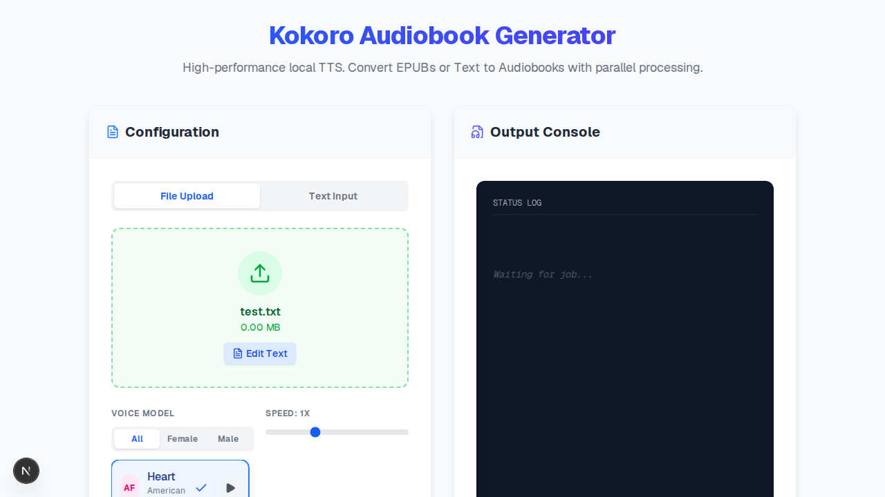

PR Title: feat: Edit Uploaded Text File Before Generation

The Problem Solved: Users often upload TXT files that have minor errors, preamble, or formatting issues. To fix them, they previously had to edit the file locally and re-upload. This feature adds an "Edit Text" button for .txt files that seamlessly extracts the content, places it into the Text Input tab, switches modes, and clears the file selection.

Visuals: 

Implementation Journey:
- Modified the file upload dropzone UI in `web-ui/src/app/page.tsx`.
- Added conditional rendering for an "Edit Text" button when the file ends in `.txt`.
- Implemented `await file.text()` to read the content and populate the `textInput` state.
- Switched `inputMode` to `text` and cleared the selected file to provide a seamless transition to the editor.
- Wrote and executed a Playwright verification script to assert the button exists, clicking it populates the textarea, and the input mode switches correctly.

Tradeoffs & Assumptions:
- I assumed that editing the text would clear the file selection rather than keeping both in sync, because the backend logic handles "File Mode" and "Text Mode" mutually exclusively.
- Brainstormed options included: (A) standard button next to file details (chosen), (B) immediately switching modes upon dropping a TXT file (rejected as it might be jarring for users who just want to upload and generate), (C) opening an in-place modal editor (rejected as too complex for the surgical change protocol). I chose (A) for simplicity and user control.

Testing Instructions:
1. Start the Next.js dev server with `npm run dev` in the `web-ui` directory.
2. Navigate to `http://localhost:3000`.
3. Drop a `.txt` file into the upload zone.
4. Verify the "Edit Text" button appears below the file details.
5. Click the "Edit Text" button.
6. Verify the UI switches to the "Text Input" tab and the textarea is populated with the contents of the `.txt` file.

Action Item: Use git to commit the changes and then use the submission tool.
